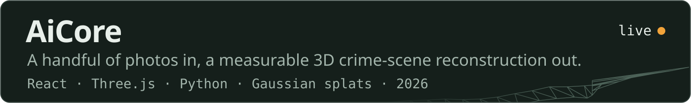
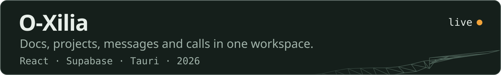
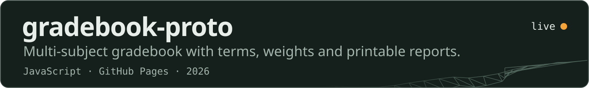
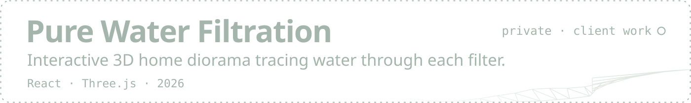
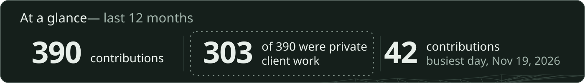

<picture>
  <source media="(prefers-color-scheme: dark)" srcset="https://raw.githubusercontent.com/Joegramming/Joegramming/main/assets/banner-dark.svg">
  <source media="(prefers-color-scheme: light)" srcset="https://raw.githubusercontent.com/Joegramming/Joegramming/main/assets/banner-light.svg">
  
</picture>

<picture>
  <source media="(prefers-color-scheme: dark)" srcset="https://readme-typing-svg.demolab.com/?font=Bricolage%20Grotesque&weight=500&size=24&duration=2800&pause=1600&color=A3B5AC&center=true&vCenter=true&width=640&height=44&lines=Interactive%203D%20for%20the%20web;Photos%20in%2C%203D%20crime%20scenes%20out;From%20Baguio%20City%20to%20Australia">
  <source media="(prefers-color-scheme: light)" srcset="https://readme-typing-svg.demolab.com/?font=Bricolage%20Grotesque&weight=500&size=24&duration=2800&pause=1600&color=4C5F56&center=true&vCenter=true&width=640&height=44&lines=Interactive%203D%20for%20the%20web;Photos%20in%2C%203D%20crime%20scenes%20out;From%20Baguio%20City%20to%20Australia">
  
</picture>

**Coding from cloudy Baguio, shipping to sunny Australia.** 
I'm one of the developers behind **[Cre8tive Sync](https://cre8tivesync.online)**, where we turn ideas into interactive, eye-catching online platforms built to run smoothly, help businesses stand out, and grow alongside them.

<picture>
  <source media="(prefers-color-scheme: dark)" srcset="https://raw.githubusercontent.com/Joegramming/Joegramming/main/assets/divider-dark.svg">
  <source media="(prefers-color-scheme: light)" srcset="https://raw.githubusercontent.com/Joegramming/Joegramming/main/assets/divider-light.svg">
  
</picture>

### Featured work

<picture>
  <source media="(prefers-color-scheme: dark)" srcset="https://raw.githubusercontent.com/Joegramming/Joegramming/main/assets/card-aicore-dark.svg">
  <source media="(prefers-color-scheme: light)" srcset="https://raw.githubusercontent.com/Joegramming/Joegramming/main/assets/card-aicore-light.svg">
  
</picture>

<a href="https://ai-core-cre8tivesync.vercel.app">Open AiCore ↗</a> · ai-core-cre8tivesync.vercel.app

<picture>
  <source media="(prefers-color-scheme: dark)" srcset="https://raw.githubusercontent.com/Joegramming/Joegramming/main/assets/card-oxilia-dark.svg">
  <source media="(prefers-color-scheme: light)" srcset="https://raw.githubusercontent.com/Joegramming/Joegramming/main/assets/card-oxilia-light.svg">
  
</picture>

<a href="https://www.oxilia.online/">Open O-Xilia ↗</a> · www.oxilia.online

<picture>
  <source media="(prefers-color-scheme: dark)" srcset="https://raw.githubusercontent.com/Joegramming/Joegramming/main/assets/card-gradebook-dark.svg">
  <source media="(prefers-color-scheme: light)" srcset="https://raw.githubusercontent.com/Joegramming/Joegramming/main/assets/card-gradebook-light.svg">
  
</picture>

<a href="https://joegramming.github.io/gradebook-proto/">Open gradebook-proto ↗</a> · joegramming.github.io/gradebook-proto

<picture>
  <source media="(prefers-color-scheme: dark)" srcset="https://raw.githubusercontent.com/Joegramming/Joegramming/main/assets/card-purewater-dark.svg">
  <source media="(prefers-color-scheme: light)" srcset="https://raw.githubusercontent.com/Joegramming/Joegramming/main/assets/card-purewater-light.svg">
  
</picture>

The dotted card is private client work. Ask me for a walkthrough.

<picture>
  <source media="(prefers-color-scheme: dark)" srcset="https://raw.githubusercontent.com/Joegramming/Joegramming/main/assets/divider-dark.svg">
  <source media="(prefers-color-scheme: light)" srcset="https://raw.githubusercontent.com/Joegramming/Joegramming/main/assets/divider-light.svg">
  
</picture>

### Tech stack

<b>Daily drivers</b> 
<picture>
  <source media="(prefers-color-scheme: dark)" srcset="https://skillicons.dev/icons?i=react%2Cthreejs%2Cts%2Csupabase%2Cnodejs%2Cvercel%2Cvite&perline=7&theme=dark">
  <source media="(prefers-color-scheme: light)" srcset="https://skillicons.dev/icons?i=react%2Cthreejs%2Cts%2Csupabase%2Cnodejs%2Cvercel%2Cvite&perline=7&theme=light">
  
</picture>

<b>Languages</b> 
<picture>
  <source media="(prefers-color-scheme: dark)" srcset="https://skillicons.dev/icons?i=js%2Cpython%2Cjava%2Ckotlin%2Cphp%2Crust&perline=6&theme=dark">
  <source media="(prefers-color-scheme: light)" srcset="https://skillicons.dev/icons?i=js%2Cpython%2Cjava%2Ckotlin%2Cphp%2Crust&perline=6&theme=light">
  
</picture>

<b>Web and backend</b> 
<picture>
  <source media="(prefers-color-scheme: dark)" srcset="https://skillicons.dev/icons?i=html%2Ccss%2Cnextjs%2Cexpress%2Cflask%2Cfastapi%2Claravel%2Cdeno%2Cjquery&perline=9&theme=dark">
  <source media="(prefers-color-scheme: light)" srcset="https://skillicons.dev/icons?i=html%2Ccss%2Cnextjs%2Cexpress%2Cflask%2Cfastapi%2Claravel%2Cdeno%2Cjquery&perline=9&theme=light">
  
</picture>

<b>Data and AI</b> 
<picture>
  <source media="(prefers-color-scheme: dark)" srcset="https://skillicons.dev/icons?i=postgres%2Cmysql%2Cmongodb%2Csqlite%2Cfirebase%2Ctensorflow%2Cpytorch%2Csklearn%2Copencv%2Canaconda&perline=10&theme=dark">
  <source media="(prefers-color-scheme: light)" srcset="https://skillicons.dev/icons?i=postgres%2Cmysql%2Cmongodb%2Csqlite%2Cfirebase%2Ctensorflow%2Cpytorch%2Csklearn%2Copencv%2Canaconda&perline=10&theme=light">
  
</picture>

<b>Tools</b> 
<picture>
  <source media="(prefers-color-scheme: dark)" srcset="https://skillicons.dev/icons?i=git%2Cgithub%2Cgithubactions%2Cgitlab%2Cdocker%2Cpostman%2Cnotion%2Cvscode%2Cpycharm%2Ctauri%2Celectron%2Carduino&perline=6&theme=dark">
  <source media="(prefers-color-scheme: light)" srcset="https://skillicons.dev/icons?i=git%2Cgithub%2Cgithubactions%2Cgitlab%2Cdocker%2Cpostman%2Cnotion%2Cvscode%2Cpycharm%2Ctauri%2Celectron%2Carduino&perline=6&theme=light">
  
</picture>

<picture>
  <source media="(prefers-color-scheme: dark)" srcset="https://raw.githubusercontent.com/Joegramming/Joegramming/main/assets/divider-dark.svg">
  <source media="(prefers-color-scheme: light)" srcset="https://raw.githubusercontent.com/Joegramming/Joegramming/main/assets/divider-light.svg">
  
</picture>

### Numbers

<picture>
  <source media="(prefers-color-scheme: dark)" srcset="https://github-readme-stats.vercel.app/api?username=Joegramming&bg_color=111B17&title_color=E8EFEA&text_color=A3B5AC&icon_color=F2A33A&border_color=2C3B35&border_radius=12&show_icons=true&ring_color=F2A33A&disable_animations=true&custom_title=Joe+on+GitHub&count_private=true">
  <source media="(prefers-color-scheme: light)" srcset="https://github-readme-stats.vercel.app/api?username=Joegramming&bg_color=F4F7F5&title_color=13201B&text_color=4C5F56&icon_color=B8560B&border_color=CBD8D1&border_radius=12&show_icons=true&ring_color=B8560B&disable_animations=true&custom_title=Joe+on+GitHub&count_private=true">
  
</picture>
<picture>
  <source media="(prefers-color-scheme: dark)" srcset="https://github-readme-stats.vercel.app/api/top-langs/?username=Joegramming&bg_color=111B17&title_color=E8EFEA&text_color=A3B5AC&icon_color=F2A33A&border_color=2C3B35&border_radius=12&layout=compact&langs_count=8&card_width=450&disable_animations=true">
  <source media="(prefers-color-scheme: light)" srcset="https://github-readme-stats.vercel.app/api/top-langs/?username=Joegramming&bg_color=F4F7F5&title_color=13201B&text_color=4C5F56&icon_color=B8560B&border_color=CBD8D1&border_radius=12&layout=compact&langs_count=8&card_width=450&disable_animations=true">
  
</picture>

<picture>
  <source media="(prefers-color-scheme: dark)" srcset="https://raw.githubusercontent.com/Joegramming/Joegramming/output/numbers-dark.svg">
  <source media="(prefers-color-scheme: light)" srcset="https://raw.githubusercontent.com/Joegramming/Joegramming/output/numbers-light.svg">
  
</picture>

<picture>
  <source media="(prefers-color-scheme: dark)" srcset="https://raw.githubusercontent.com/Joegramming/Joegramming/output/snake-dark.svg">
  <source media="(prefers-color-scheme: light)" srcset="https://raw.githubusercontent.com/Joegramming/Joegramming/output/snake-light.svg">
  
</picture>

<picture>
  <source media="(prefers-color-scheme: dark)" srcset="https://raw.githubusercontent.com/Joegramming/Joegramming/main/assets/divider-dark.svg">
  <source media="(prefers-color-scheme: light)" srcset="https://raw.githubusercontent.com/Joegramming/Joegramming/main/assets/divider-light.svg">
  
</picture>

### Say yo

   

previously <a href="https://github.com/wehejojo">@wehejojo</a>

